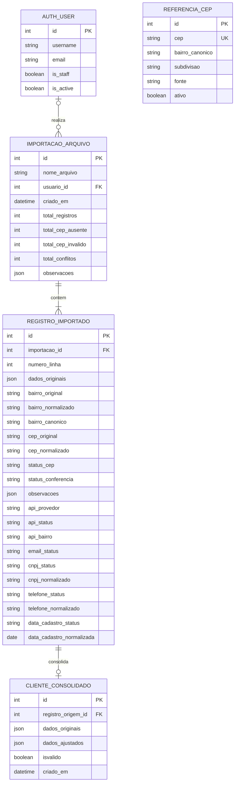
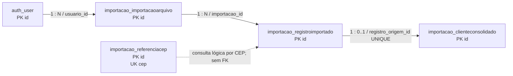

# ETL – Qualidade de Dados de Clientes do DF

Sistema web desenvolvido com **Django** para importar planilhas Excel/CSV, analisar a qualidade dos dados cadastrais, normalizar campos, consultar informações de CEP em serviços externos e persistir os registros consolidados para consulta.

> Esta versão disponibiliza páginas web Django. **Não há uma API REST própria implementada no código**; portanto, não existem endpoints JSON próprios para documentar com Swagger/OpenAPI. A documentação abaixo descreve as rotas web e as integrações externas de CEP efetivamente utilizadas.

## 1. Descrição do sistema

### Funcionalidades

- Autenticação pelo sistema nativo do Django.
- Upload de arquivos `.xlsx` e `.csv`, com limite de 10 MB.
- Leitura de Excel com Pandas/OpenPyXL e CSV separado por `;`.
- Validação e normalização de bairro, CEP, CNPJ, telefone, e-mail e data de cadastro.
- Consulta de CEP no ViaCEP e, quando necessário, na BrasilAPI.
- Exibição dos valores originais, alertas e dados normalizados.
- Gravação dos dados originais e ajustados em `ClienteConsolidado`.
- Classificação do registro pelo campo `isvalido`.
- Pesquisa dos registros persistidos e filtro por situação.
- Cadastro de usuários permitido somente a usuários com `is_staff=True`.

### Fluxo geral

1. O usuário autentica-se no sistema.
2. Acessa **Upload de Excel** e seleciona um arquivo `.xlsx` ou `.csv`.
3. O sistema verifica as colunas obrigatórias `bairro_informado` e `cep`.
4. Cada linha é analisada e salva como `RegistroImportado`, vinculada a um lote (`ImportacaoArquivo`).
5. O usuário revisa valores originais, normalizações e alertas.
6. Ao acionar a gravação do lote, os registros são inseridos/atualizados em `ClienteConsolidado`.
7. A tela **Consulta de dados** permite pesquisar e filtrar os registros consolidados.

### Regras de validade

`ClienteConsolidado.isvalido` é `false` quando há pelo menos uma condição tratada como erro crítico pela função `registro_tem_erro_vermelho`:

- e-mail com status `INVALIDO`;
- CNPJ com status `INVALIDO`;
- telefone com status `INVALIDO`;
- data de cadastro com status `INVALIDA`;
- CEP ausente ou inválido;
- conferência com status `CONFLITO`;
- bairro canônico não identificado.

Alertas de correção de formato (laranja) não invalidam o registro por si só. Sem erro crítico, `isvalido=true`.

### Regras de normalização

- **Bairro:** normalização textual sem acentos e aliases conhecidos para Águas Claras, Taguatinga, Vicente Pires e Guará. Subdivisões reconhecidas são preservadas.
- **CEP:** remove caracteres não numéricos e verifica oito dígitos, rejeitando `00000000`. O formato correto não comprova, sozinho, a correspondência geográfica.
- **CNPJ:** exige 14 dígitos para aplicar `00.000.000/0000-00`. A rotina não valida dígitos verificadores.
- **Telefone:** aceita número brasileiro com DDD e 8 ou 9 dígitos, com ou sem `55`; normaliza para `+55 DD XXXX-XXXX` ou `+55 DD XXXXX-XXXX`.
- **E-mail:** valida sintaxe com o validador do Django; não verifica se a caixa postal existe.
- **Data:** reconhece formatos numéricos e textuais em português/inglês implementados em `importacao/services.py`, normalizando para `DD/MM/YYYY` quando possível.

## 2. Tecnologias e dependências

- Python 3.10 ou superior (recomendado).
- Django `>=5.0,<6.0`.
- Pandas `>=2.2`.
- OpenPyXL `>=3.1`.
- Requests `>=2.31`.
- SQLite (banco configurado por padrão).
- Bootstrap 5.3.3 via CDN para a interface.

As versões declaradas estão em `requirements.txt`.

## 3. Criar ambiente virtual

Execute os comandos na pasta que contém `manage.py` (diretório `django_etl_df`).

### Windows – PowerShell

```powershell
py -m venv .venv
.\.venv\Scripts\Activate.ps1
```

Alternativa pelo Prompt de Comando:

```bat
.venv\Scripts\activate.bat
```

### Linux / macOS

```bash
python3 -m venv .venv
source .venv/bin/activate
```

## 4. Instalar pacotes necessários

Com o ambiente virtual ativado:

```bash
python -m pip install --upgrade pip
pip install -r requirements.txt
```

Conteúdo de `requirements.txt`:

```text
Django>=5.0,<6.0
pandas>=2.2
openpyxl>=3.1
requests>=2.31
```

## 5. Instruções para execução

### 5.1 Entrar na pasta do projeto Django

```bash
cd django_etl_df
```

Esta é a pasta onde está `manage.py`.

### 5.2 Criar as tabelas

O projeto usa SQLite por padrão e inclui migrações iniciais da aplicação. Execute:

```bash
python manage.py migrate
```

Se os modelos forem alterados durante o desenvolvimento:

```bash
python manage.py makemigrations importacao
python manage.py migrate
```

### 5.3 Criar o primeiro administrador

```bash
python manage.py createsuperuser
```

Informe usuário e senha. O usuário administrativo pode acessar `/admin/` e cadastrar usuários pela opção do menu.

### 5.4 Iniciar o servidor

```bash
python manage.py runserver
```

Acesse:

- Sistema: <http://127.0.0.1:8000/>
- Login: <http://127.0.0.1:8000/login/>
- Administração Django: <http://127.0.0.1:8000/admin/>

A rota inicial redireciona usuários não autenticados para login e usuários autenticados para upload.

Para encerrar o servidor, pressione `Ctrl+C` no terminal.

## 6. Utilização

### Upload e processamento

1. Faça login e acesse **Upload de Excel**.
2. Selecione `.xlsx` ou `.csv` de até 10 MB.
3. Confirme que o arquivo contém `bairro_informado` e `cep`.
4. Revise dados originais e alertas.
5. Utilize o botão de gravação do lote para persistir os dados originais e ajustados.

Para CSV, o sistema tenta `utf-8-sig` e depois `latin-1`, utilizando `;` como separador.

### Consulta

Acesse **Consulta de dados** para pesquisar registros persistidos. A pesquisa considera dados originais e ajustados e campos relacionados como bairro, CEP, CNPJ, telefone e nome do arquivo. O filtro permite exibir todos, somente válidos ou somente inválidos. A listagem é paginada em 25 registros.

### Cadastro de usuários

A opção **Cadastrar usuário** aparece somente para usuários com `is_staff=True`. Rota: `/importacao/usuarios/novo/`. O formulário utiliza `UserCreationForm` do Django e suas validações de senha.

## 7. Documentação das rotas e integrações

### 7.1 Rotas web do sistema

Definidas em `config/urls.py` e `importacao/urls.py`.

| Método | Caminho | Nome | Acesso | Descrição |
|---|---|---|---|---|
| GET | `/` | `home` | Público/autenticado | Redireciona para login ou upload |
| GET/POST | `/login/` | `login` | Público | Autenticação |
| POST | `/logout/` | `logout` | Autenticado | Encerra sessão |
| GET/POST | `/importacao/upload/` | `importacao:upload_excel` | Login obrigatório | Formulário e processamento de arquivo |
| POST | `/importacao/lote/<lote_id>/salvar/` | `importacao:salvar_lote` | Login e dono do lote | Persiste registros consolidados |
| GET | `/importacao/consolidados/` | `importacao:listar_consolidados` | Login obrigatório | Consulta, pesquisa e filtro |
| GET/POST | `/importacao/usuarios/novo/` | `importacao:cadastrar_usuario` | Somente `is_staff` | Cadastra usuário |
| GET | `/admin/` | Django Admin | Conforme permissões | Administração |

`/logout/` usa `LogoutView` do Django e deve ser chamado por POST nas versões atuais do framework.

### 7.2 Parâmetros da pesquisa

A rota `/importacao/consolidados/` recebe parâmetros pela query string:

| Parâmetro | Tipo | Valores | Finalidade |
|---|---|---|---|
| `q` | Texto | Livre | Termo de pesquisa |
| `isvalido` | Texto | `true`, `false` ou vazio | Filtra válidos, inválidos ou todos |
| `page` | Inteiro | 1, 2, 3... | Página |

Exemplo:

```text
/importacao/consolidados/?q=Taguatinga&isvalido=true&page=1
```

### 7.3 Integrações externas de CEP

Não são endpoints do próprio Django. O serviço `consultar_cep_api` acessa:

| Provedor | Método e endpoint | Uso |
|---|---|---|
| ViaCEP | `GET https://viacep.com.br/ws/{cep}/json/` | Primeira tentativa |
| BrasilAPI | `GET https://brasilapi.com.br/api/cep/v2/{cep}` | Fallback ou complemento quando ViaCEP falha/não retorna bairro |

As chamadas usam timeout. O resultado é armazenado no registro importado, incluindo provedor, status, bairro, cidade, UF, logradouro e resposta JSON. A consulta depende de internet e da disponibilidade dos serviços externos.

### 7.4 API REST / Swagger

O código atual não contém Django REST Framework, Django Ninja ou `drf-spectacular`, nem define endpoints REST próprios. Portanto, não há Swagger/OpenAPI nesta versão. As rotas documentadas acima são páginas e ações web do Django.

Como evolução futura, podem ser criados serializers, endpoints REST versionados e autenticação própria para API; em seguida, `drf-spectacular` pode gerar a especificação OpenAPI e a interface Swagger. Isso não faz parte da implementação atual.

## 8. Modelo de dados

O banco padrão é SQLite (`db.sqlite3`). Os modelos da aplicação estão em `importacao/models.py`. O Django também cria tabelas internas para usuários, grupos, permissões e sessões.

### 8.1 Entidades

| Entidade | Responsabilidade |
|---|---|
| `ImportacaoArquivo` | Lote de arquivo importado e totais |
| `RegistroImportado` | Linha analisada, dados originais, normalizações, status e retorno da API |
| `ReferenciaCEP` | Cadastro auxiliar de CEP e bairro de referência |
| `ClienteConsolidado` | Dados originais/ajustados persistidos e validade |
| `auth_user` (Django) | Usuários que acessam o sistema; referenciados pelo lote |

### 8.2 MER – Modelo Entidade-Relacionamento



`ReferenciaCEP` é uma tabela auxiliar independente no modelo atual: não existe chave estrangeira dela para `RegistroImportado`. A aplicação consulta essa tabela por CEP durante a análise.

### 8.3 DER – Diagrama de tabelas e cardinalidades



- Um usuário pode realizar várias importações; `usuario` aceita `NULL` e usa `SET_NULL` quando o usuário é removido.
- Uma importação contém vários registros; excluir o lote exclui seus registros (`CASCADE`).
- Um registro importado pode ter no máximo um consolidado, devido ao `OneToOneField`.
- O consolidado protege o registro de origem contra exclusão (`PROTECT`).
- `ReferenciaCEP.cep` é único. A associação com registros é feita pela lógica da aplicação, não por relacionamento físico.

### 8.4 Campos de `ClienteConsolidado`

| Campo | Tipo Django | Descrição |
|---|---|---|
| `registro_origem` | `OneToOneField` | Registro que originou a consolidação |
| `dados_originais` | `JSONField` | Conteúdo recebido no arquivo |
| `dados_ajustados` | `JSONField` | Conteúdo após normalizações aplicáveis |
| `isvalido` | `BooleanField`, indexado | `false` para erro crítico; `true` sem erro crítico |
| `criado_em` | `DateTimeField` | Data/hora de criação |

## 9. Estrutura principal do projeto

```text
django_etl_df/
├── manage.py
├── requirements.txt
├── README.md
├── db.sqlite3                 # criado após migrações/uso do sistema
├── config/
│   ├── settings.py
│   ├── urls.py
│   ├── asgi.py
│   └── wsgi.py
└── importacao/
    ├── admin.py
    ├── apps.py
    ├── forms.py
    ├── models.py
    ├── services.py
    ├── tests.py
    ├── urls.py
    ├── views.py
    ├── migrations/
    ├── templatetags/
    └── templates/importacao/
        ├── login.html
        ├── upload.html
        ├── consolidados.html
        └── cadastrar_usuario.html
```

## 10. Administração e referência de CEP

`ReferenciaCEP` não vem preenchida. Para utilizar a conferência por referência local, acesse `/admin/` com uma conta administrativa e cadastre CEP com oito dígitos, bairro canônico, subdivisão (se aplicável), fonte e indicador `ativo`.

O cadastro local é distinto da consulta externa ViaCEP/BrasilAPI. O sistema não deve tratar apenas oito dígitos como prova de que o CEP pertence a determinado bairro.

## 11. Testes e verificações

Execute os testes automatizados:

```bash
python manage.py test
```

Verifique a configuração Django:

```bash
python manage.py check
```

Execute os comandos no ambiente virtual, a partir da pasta que contém `manage.py`.

## 12. Segurança e implantação

A configuração incluída é voltada ao desenvolvimento. Antes de publicar em produção:

- Defina `DJANGO_SECRET_KEY` por variável de ambiente e substitua a chave insegura padrão.
- Configure `DEBUG=False`.
- Configure `ALLOWED_HOSTS` para os domínios autorizados.
- Utilize HTTPS e cookies seguros.
- Utilize banco de dados adequado à produção e faça backups.
- Restrinja o acesso ao painel administrativo.
- Revise limites de upload e política de armazenamento.
- Não exponha `db.sqlite3`, arquivos enviados ou segredos no repositório.
- Configure servidor WSGI/ASGI de produção; não utilize `runserver` em produção.

No estado atual, `DEBUG=True`, `ALLOWED_HOSTS` contém `127.0.0.1` e `localhost`, e o banco padrão é SQLite.

## 13. Limitações conhecidas

- A consulta a CEP depende de serviços de terceiros e conexão com a internet.
- A consulta externa não substitui uma base postal oficial ou conferência humana.
- O validador de e-mail verifica sintaxe, não existência da caixa postal.
- A validação de CNPJ verifica quantidade de dígitos e máscara, não os dígitos verificadores.
- A validação de telefone verifica estrutura e formatação, não se a linha está ativa.
- A referência local de CEP precisa ser alimentada pela equipe.
- A aplicação não fornece API REST própria nesta versão.
