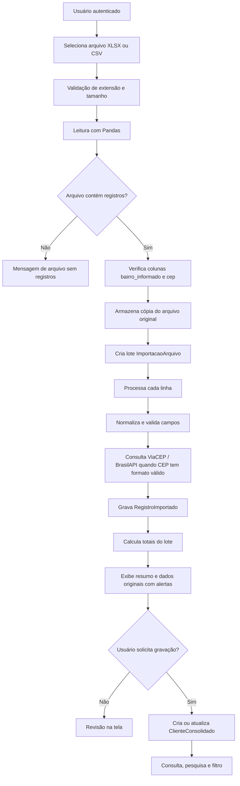
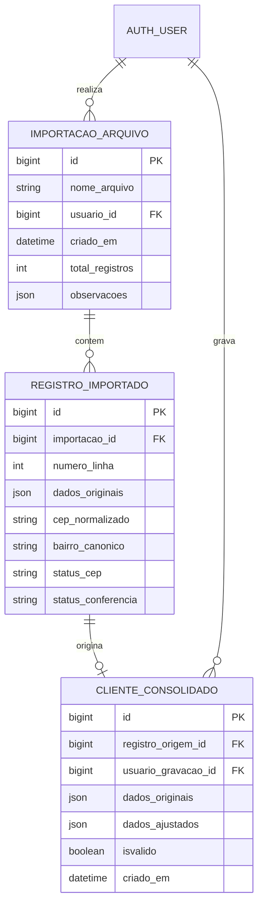

# Documentação Técnica — ETL de Qualidade de Dados de Clientes do DF

**Projeto:** `Sistema de Analise de Documento`  
**Aplicação Django:** `importacao`  
**Escopo:** arquitetura, módulos, modelos, processamento ETL, validações, persistência, telas, rotas, configuração e operação.

> Esta documentação descreve a implementação encontrada no ZIP analisado. Quando uma funcionalidade não está implementada no código, isso é indicado explicitamente. O projeto é uma aplicação web Django; não implementa uma API REST própria.

---

## 1. Visão geral

O sistema importa arquivos Excel (`.xlsx`) e CSV (`.csv`) contendo dados cadastrais de clientes, analisa a qualidade das informações, normaliza campos, consulta dados de CEP em serviços externos e permite gravar os resultados consolidados no banco de dados.

As funcionalidades identificadas são:

- autenticação de usuários pela estrutura nativa do Django;
- upload de planilhas Excel e CSV, limitado a 10 MB;
- leitura de dados com Pandas e OpenPyXL;
- validação e normalização de bairro, CEP, CNPJ, telefone, e-mail e data de cadastro;
- consulta de CEP via ViaCEP, com BrasilAPI como alternativa/complemento;
- exibição dos dados originais com indicadores de validação;
- gravação de dados originais e ajustados;
- pesquisa e filtro dos registros consolidados;
- armazenamento dos arquivos originais para consulta e download;
- cadastro, habilitação/desabilitação e redefinição de senha de usuários por usuários com `is_staff=True`.

## 2. Arquitetura e tecnologias

### 2.1 Tecnologias

| Tecnologia | Utilização identificada |
|---|---|
| Python | Linguagem da aplicação |
| Django 5.x | Framework web, autenticação, ORM, formulários e administração |
| Pandas | Leitura e manipulação das planilhas |
| OpenPyXL | Leitura de arquivos `.xlsx` |
| Requests | Requisições HTTP às APIs de CEP |
| SQLite | Banco de dados configurado por padrão |
| Bootstrap 5.3.3 | Componentes e estilos das páginas, carregados por CDN |

As dependências declaradas em `requirements.txt` são:

```text
Django>=5.0,<6.0
pandas>=2.2
openpyxl>=3.1
requests>=2.31
```

### 2.2 Organização de diretórios

```text
django_etl_df/
├── manage.py
├── requirements.txt
├── README.md
├── config/
│   ├── __init__.py
│   ├── settings.py
│   ├── urls.py
│   ├── asgi.py
│   └── wsgi.py
└── importacao/
    ├── __init__.py
    ├── admin.py
    ├── apps.py
    ├── forms.py
    ├── models.py
    ├── services.py
    ├── tests.py
    ├── urls.py
    ├── templatetags/
    │   ├── __init__.py
    │   └── etl_tags.py
    ├── migrations/
    └── templates/importacao/
        ├── login.html
        ├── upload.html
        ├── consolidados.html
        └── cadastrar_usuario.html
```

### 2.3 Responsabilidade por módulo

| Arquivo | Responsabilidade |
|---|---|
| `manage.py` | Inicialização dos comandos administrativos do Django |
| `config/settings.py` | Configurações gerais, banco, autenticação, mídia e aplicações instaladas |
| `config/urls.py` | Rotas globais, login, logout, administração e inclusão das rotas da aplicação |
| `config/wsgi.py` / `config/asgi.py` | Pontos de entrada WSGI e ASGI |
| `importacao/models.py` | Estrutura das entidades persistidas |
| `importacao/forms.py` | Validação do upload e formulário de cadastro de usuário |
| `importacao/services.py` | Regras ETL, normalização, validações e consultas externas de CEP |
| `importacao/views.py` | Controle das requisições, upload, gravação, consulta, download e usuários |
| `importacao/urls.py` | Rotas específicas da aplicação |
| `importacao/admin.py` | Registro e configuração dos modelos no Django Admin |
| `importacao/tests.py` | Testes unitários existentes para normalização de bairro e CEP |
| `importacao/templatetags/etl_tags.py` | Filtro `get_item` para obter valor de dicionário nos templates |
| `templates/importacao/*.html` | Interface web do sistema |

## 3. Fluxo funcional do ETL

O processamento segue as etapas abaixo:



### 3.1 Entrada de dados

A view `upload_excel` recebe o arquivo pelo campo `arquivo` do formulário `ExcelUploadForm`.

- Para `.csv`, a função `ler_csv` tenta primeiro `utf-8-sig` e depois `latin-1`.
- O separador CSV utilizado é ponto e vírgula (`;`).
- A leitura CSV usa `dtype=str` e `keep_default_na=False`.
- Para `.xlsx`, utiliza `pandas.read_excel(..., engine="openpyxl", dtype=str)` e substitui valores nulos por texto vazio.
- Os cabeçalhos são preservados; não há renomeação automática de colunas.
- As colunas obrigatórias verificadas no código são `bairro_informado` e `cep`.

As demais colunas são mantidas nos dicionários de dados originais. As regras específicas de validação são aplicadas aos campos `email`, `cnpj`, `telefone` e `data_cadastro`, além de bairro e CEP.

### 3.2 Criação do lote e processamento das linhas

Após leitura e verificação das colunas, o arquivo original é salvo no storage padrão do Django em `importacoes/`, com nome passado por `get_valid_filename`.

Em seguida, dentro de `transaction.atomic()`:

1. é criado um registro `ImportacaoArquivo`;
2. cada linha é convertida em dicionário;
3. `salvar_linha` chama `analisar_registro`;
4. a análise produz os valores normalizados, status e observações;
5. a linha é persistida como `RegistroImportado`;
6. os totais de CEP ausente, CEP inválido e conflitos são calculados;
7. o lote é atualizado.

A numeração de linha começa em 2, considerando a primeira linha como cabeçalho.

### 3.3 Consolidação

A consolidação é uma ação separada do upload. A view `salvar_lote` aceita somente requisição POST e verifica se o lote pertence ao usuário autenticado (`lote.usuario == request.user`).

Para cada `RegistroImportado`, são preparados:

- `dados_originais`: cópia do conteúdo importado;
- `dados_ajustados`: cópia dos dados originais com substituição dos campos para os quais há valor normalizado;
- `usuario_gravacao`: usuário que acionou a consolidação;
- `isvalido`: resultado dos critérios de erro crítico.

A operação utiliza `update_or_create`, usando `registro_origem` como chave, evitando duplicar o consolidado para a mesma linha de origem.

## 4. Regras de validação e normalização

As regras estão implementadas principalmente em `importacao/services.py`.

### 4.1 Bairro

Funções: `sem_acentos`, `chave_texto` e `normalizar_bairro`.

O processamento:

- remove acentos;
- converte o texto para maiúsculas;
- remove referências textuais `DF` e `DISTRITO FEDERAL`;
- substitui pontuação e caracteres especiais por espaços;
- reduz espaços repetidos;
- reconhece aliases e subdivisões previstas no código.

Aliases configurados:

| Entrada normalizada | Bairro canônico |
|---|---|
| `AGUAS CLARAS` | Águas Claras |
| `AGUAS CLARA` | Águas Claras |
| `TAGUATINGA` | Taguatinga |
| `VICENTE PIRES` | Vicente Pires |
| `VTE PIRES` | Vicente Pires |
| `V PIRES` | Vicente Pires |
| `GUARA` | Guará |

Subdivisões reconhecidas incluem Norte/Sul de Águas Claras, Norte/Sul de Taguatinga e Guará I/II (também representado por 1/2). A subdivisão é armazenada separadamente.

Quando o bairro está vazio, é gerada a observação `BAIRRO_AUSENTE`. Quando não é reconhecido para canonicalização, é gerada `BAIRRO_NAO_RECONHECIDO_PARA_CANONICALIZACAO`.

### 4.2 CEP

Função: `normalizar_cep`.

- Remove todos os caracteres que não sejam dígitos.
- Valor vazio recebe status `AUSENTE`.
- Exige exatamente oito dígitos.
- Rejeita `00000000`.
- CEP com oito dígitos recebe `FORMATO_VALIDO`.

`FORMATO_VALIDO` representa apenas validação estrutural; não comprova que o CEP exista ou corresponda ao bairro informado.

### 4.3 Consulta de CEP por API

Função: `consultar_cep_api`, decorada com `lru_cache(maxsize=4096)`.

A ordem de consulta é:

1. ViaCEP: `GET https://viacep.com.br/ws/{cep}/json/`;
2. BrasilAPI: `GET https://brasilapi.com.br/api/cep/v2/{cep}` como fallback ou complemento quando ViaCEP falha, não encontra o CEP ou não informa bairro.

As requisições usam timeout `(3, 6)`, cabeçalhos `Accept: application/json` e `User-Agent`. O cache reduz consultas repetidas ao mesmo CEP durante a execução do processo.

Os dados retornados são mapeados para provedor, status, bairro, cidade, UF, logradouro e resposta JSON original. Os estados de retorno definidos no serviço incluem `CONSULTADO`, `NAO_ENCONTRADO` e `INDISPONIVEL`.

Regras de comparação:

- Se a API retorna UF diferente de `DF`, a conferência recebe `CONFLITO`.
- Se a API não retorna bairro, é registrada observação para revisão; a comparação pode permanecer não verificada.
- Quando os bairros canônicos informado e retornado são conhecidos, são comparados.
- Se os bairros canônicos forem iguais, o status é `COMPATIVEL`.
- Se forem diferentes, o status é `DIVERGENCIA_API`.
- Quando não há confirmação pela API, o código pode consultar a tabela local `ReferenciaCEP`, se existir referência ativa para o CEP.
- Se o bairro informado não for canonicalizado, o status final é `BAIRRO_NAO_IDENTIFICADO`.

Uma falha ou indisponibilidade da API não é, por si só, prova de que o bairro esteja incorreto.

### 4.4 E-mail

Função: `validar_email`.

- Campo vazio: `AUSENTE`.
- Campo preenchido: validado com `django.core.validators.validate_email`.
- Sintaxe aceita: `VALIDO`.
- Sintaxe rejeitada: `INVALIDO`.

A implementação verifica a sintaxe, não a existência da caixa postal nem a capacidade de recebimento.

### 4.5 CNPJ

Função: `validar_cnpj`.

- Campo vazio: `AUSENTE`.
- Remove caracteres não numéricos para contar dígitos.
- Exige 14 dígitos para aplicar a máscara `00.000.000/0000-00`.
- Se a quantidade for diferente de 14, retorna `FORMATO_INCORRETO` sem CNPJ normalizado.
- Se os 14 dígitos existem, monta a máscara.
- Se a apresentação original difere da máscara, retorna `FORMATO_INCORRETO`, mas fornece o valor formatado.
- Se já está na máscara, retorna `VALIDO`.

**Limite importante:** o código declara expressamente que não valida os dígitos verificadores do CNPJ. Portanto, `VALIDO` significa formato correto e 14 dígitos, não confirmação de que o CNPJ seja matematicamente ou cadastralmente válido.

### 4.6 Telefone

Função: `validar_telefone`.

- Campo vazio: `AUSENTE`.
- Remove caracteres não numéricos.
- Aceita 10 ou 11 dígitos nacionais (DDD + número).
- Também aceita 12 ou 13 dígitos quando começam com `55`, removendo o código do país para normalizar.
- Número com 8 dígitos após o DDD é formatado como `+55 DD XXXX-XXXX`.
- Número com 9 dígitos após o DDD é formatado como `+55 DD XXXXX-XXXX`.
- Quantidade não reconhecida: `INVALIDO`.
- Formato reconhecido, mas diferente do padrão final: `FORMATO_INCORRETO`, acompanhado do valor normalizado.

A implementação não consulta operadora nem confirma se o número está ativo.

### 4.7 Data de cadastro

Função: `validar_data_cadastro`.

Trata `None`, texto vazio e representações `nan`, `nat`, `none` e `null` como `AUSENTE`.

Formatos numéricos tentados:

- `%d/%m/%Y`;
- `%Y-%m-%d`;
- `%d-%m-%Y`;
- `%Y/%m/%d`;
- `%d.%m.%Y`;
- `%m/%d/%Y`.

Também reconhece nomes de meses em português e inglês, como `Jul 21, 2022`, `nov 19, 2021`, `janeiro 5, 2024`.

- Data não reconhecida ou impossível: `INVALIDA`.
- Data reconhecida no padrão `DD/MM/YYYY`: `VALIDA`.
- Data reconhecida em outro formato: `CORRIGIDA`, com objeto `date` normalizado e observação.

## 5. Critério de validade do registro

A função `registro_tem_erro_vermelho`, em `views.py`, define as condições que tornam o registro inválido na consolidação.

O registro recebe `isvalido=False` se ocorrer pelo menos uma das condições:

- `email_status == "INVALIDO"`;
- `cnpj_status == "INVALIDO"`;
- `telefone_status == "INVALIDO"`;
- `data_cadastro_status == "INVALIDA"`;
- `status_cep` igual a `AUSENTE` ou `INVALIDO`;
- `status_conferencia == "CONFLITO"`;
- bairro canônico vazio.

Caso nenhuma dessas condições ocorra, `isvalido=True`.

**Observação de implementação:** os estados `FORMATO_INCORRETO` de CNPJ e telefone e o estado `CORRIGIDA` de data não aparecem na função de erro crítico. Assim, esses alertas de formatação, isoladamente, não tornam o consolidado inválido. O status `DIVERGENCIA_API` também não está listado diretamente como erro crítico em `registro_tem_erro_vermelho`.

## 6. Estrutura do banco de dados

O banco configurado é SQLite, no arquivo `db.sqlite3`, localizado em `BASE_DIR`.

### 6.1 `ImportacaoArquivo`

Representa cada arquivo submetido ao processo ETL.

| Campo | Tipo / comportamento | Descrição |
|---|---|---|
| `id` | BigAutoField | Identificador gerado pelo Django |
| `nome_arquivo` | CharField(255) | Nome original do arquivo |
| `usuario` | FK para usuário, nulo permitido | Usuário responsável pelo upload; `SET_NULL` ao excluir usuário |
| `criado_em` | DateTimeField, `auto_now_add` | Data/hora de criação |
| `total_registros` | PositiveIntegerField | Quantidade de linhas processadas |
| `total_cep_ausente` | PositiveIntegerField | Total de CEPs ausentes |
| `total_cep_invalido` | PositiveIntegerField | Total de CEPs inválidos |
| `total_conflitos` | PositiveIntegerField | Total de conferências com status `CONFLITO` |
| `observacoes` | JSONField | Lista usada para armazenar observações e caminho do arquivo salvo |

Ordenação padrão: mais recentes primeiro.

### 6.2 `ReferenciaCEP`

Tabela auxiliar mantida pela equipe. O comentário do modelo informa que ela não vem pré-preenchida.

| Campo | Tipo / comportamento | Descrição |
|---|---|---|
| `cep` | CharField(8), único | CEP com oito dígitos |
| `bairro_canonico` | CharField(100) | Bairro de referência |
| `subdivisao` | CharField(100), opcional | Subdivisão do bairro |
| `fonte` | CharField(255), opcional | Fonte da informação |
| `ativo` | BooleanField, padrão `True` | Indica se a referência pode ser utilizada |

A consulta local é utilizada como segunda fonte quando a conferência por API permanece `NAO_VERIFICADO`.

### 6.3 `RegistroImportado`

Armazena a análise individual de cada linha do arquivo.

Principais grupos de campos:

- **Origem:** `importacao`, `numero_linha`, `dados_originais`.
- **Bairro:** `bairro_original`, `bairro_normalizado`, `bairro_canonico`, `subdivisao`.
- **CEP:** `cep_original`, `cep_normalizado`, `status_cep`, `status_conferencia`.
- **Observações:** `observacoes` (JSON).
- **API:** `api_provedor`, `api_status`, `api_bairro`, `api_cidade`, `api_uf`, `api_logradouro`, `api_resposta`.
- **E-mail:** `email_status`, `email_observacao`.
- **CNPJ:** `cnpj_status`, `cnpj_normalizado`, `cnpj_observacao`.
- **Telefone:** `telefone_status`, `telefone_normalizado`, `telefone_observacao`.
- **Data:** `data_cadastro_status`, `data_cadastro_normalizada`, `data_cadastro_observacao`.

A relação com `ImportacaoArquivo` é ForeignKey com `related_name="registros"` e exclusão em cascata (`CASCADE`). A ordenação padrão é por número da linha.

Status de CEP declarados:

| Código | Significado |
|---|---|
| `AUSENTE` | CEP não informado |
| `INVALIDO` | CEP não atende à regra estrutural |
| `FORMATO_VALIDO` | Oito dígitos e não é `00000000`; ainda pode não ter sido confirmado geograficamente |

Status de conferência declarados:

| Código | Significado |
|---|---|
| `NAO_VERIFICADO` | Sem confirmação pela referência postal |
| `COMPATIVEL` | Compatível com referência cadastrada/consulta |
| `CONFLITO` | Conflito entre bairro e CEP ou UF fora do DF |
| `DIVERGENCIA_API` | Bairro divergente da consulta à API |
| `BAIRRO_NAO_IDENTIFICADO` | Bairro não identificado |

### 6.4 `ClienteConsolidado`

Representa a versão persistida após a conferência do lote.

| Campo | Tipo / comportamento | Descrição |
|---|---|---|
| `registro_origem` | OneToOne para `RegistroImportado`, `PROTECT` | Linha de origem; impede excluir o registro de origem enquanto houver consolidado |
| `usuario_gravacao` | FK para usuário, nulo permitido, `SET_NULL` | Usuário que gravou o consolidado |
| `dados_originais` | JSONField | Dados recebidos da planilha |
| `dados_ajustados` | JSONField | Dados com os valores normalizados disponíveis |
| `isvalido` | BooleanField, indexado, padrão `True` | Resultado da regra de validade |
| `criado_em` | DateTimeField, `auto_now_add` | Data/hora de criação do consolidado |

### 6.5 Relacionamentos



`ReferenciaCEP` é consultada por CEP pelo serviço e não possui relacionamento declarativo com `RegistroImportado`.

## 7. Interface web

### 7.1 Login — `login.html`

Tela de autenticação baseada em `django.contrib.auth.views.LoginView`. Recebe usuário e senha e redireciona usuários autenticados para a página de upload.

### 7.2 Upload — `upload.html`

Apresenta o formulário de envio e, após o processamento, o resumo do lote e a tabela de dados originais com indicadores de validação.

Os indicadores do resumo incluem:

- Registros processados;
- CEP ausente;
- CEP inválido;
- Conflitos confirmados;
- Consultas API concluídas;
- Consultas API indisponíveis.

A tabela mantém os dados originais e apresenta ícones/alertas para situações como CEP ausente ou inválido, bairro compatível, divergência com API, bairro não identificado e necessidade de revisão. A tela oferece ação para gravar o lote consolidado.

### 7.3 Consulta de dados — `consolidados.html`

A tela apresenta:

- totais de registros válidos e inválidos;
- lista das planilhas importadas, com nome, data, quantidade de registros e usuário;
- ação de download do arquivo original;
- campo de pesquisa;
- filtro por todos, válidos ou inválidos;
- tabela com dados originais, dados ajustados, arquivo de origem, usuário que gravou e data de gravação;
- paginação de 25 registros por página.

A pesquisa considera os JSONs originais e ajustados e campos relacionados, incluindo bairro, CEP, CNPJ, telefone e nome do arquivo.

### 7.4 Administração de usuários — `cadastrar_usuario.html`

A tela permite:

- cadastrar usuário informando login e senha;
- visualizar usuários cadastrados;
- habilitar ou desabilitar contas;
- redefinir senha de usuários.

O acesso à view é restrito a usuários com `is_staff=True`. A aplicação impede, nessa tela, desabilitar a própria conta e alterar o status de superusuários. A redefinição de senha também bloqueia superusuários.

## 8. Rotas e controle de acesso

### 8.1 Rotas globais (`config/urls.py`)

| Método | Caminho | Nome | Acesso / finalidade |
|---|---|---|---|
| GET | `/` | `home` | Redireciona para upload se autenticado; caso contrário, login |
| GET/POST | `/login/` | `login` | Login pelo Django |
| POST | `/logout/` | `logout` | Encerra a sessão |
| GET | `/admin/` | Django Admin | Administração nativa do Django |
| — | `/importacao/` | — | Prefixo das rotas da aplicação |

### 8.2 Rotas da aplicação (`importacao/urls.py`)

| Método | Caminho | Nome | Controle de acesso / finalidade |
|---|---|---|---|
| GET/POST | `/importacao/upload/` | `importacao:upload_excel` | Login obrigatório; upload e análise |
| GET | `/importacao/consolidados/` | `importacao:listar_consolidados` | Login obrigatório; consulta e filtros |
| GET | `/importacao/importacao/<lote_id>/baixar/` | `importacao:baixar_planilha_importada` | Login obrigatório; download do original |
| GET/POST | `/importacao/usuarios/novo/` | `importacao:cadastrar_usuario` | Login e `is_staff=True` |
| POST | `/importacao/usuarios/<usuario_id>/status/` | `importacao:alternar_status_usuario` | Login e `is_staff=True` |
| POST | `/importacao/usuarios/<usuario_id>/resetar-senha/` | `importacao:resetar_senha_usuario` | Login e `is_staff=True` |
| POST | `/importacao/lote/<lote_id>/salvar/` | `importacao:salvar_lote` | Login obrigatório e lote pertencente ao usuário |

### 8.3 Parâmetros de consulta

A rota `/importacao/consolidados/` recebe:

| Parâmetro | Descrição |
|---|---|
| `q` | Termo textual de pesquisa |
| `isvalido` | `true`, `false` ou vazio para todos |
| `page` | Número da página |

Exemplo:

```text
/importacao/consolidados/?q=Taguatinga&isvalido=true&page=1
```

## 9. Segurança e permissões observadas

- Upload, consulta, download e gravação exigem usuário autenticado (`login_required`).
- O salvamento do lote verifica se o lote foi criado pelo usuário autenticado.
- Cadastro e gerenciamento de usuários verificam `request.user.is_staff` e lançam `PermissionDenied` quando a condição não é atendida.
- As ações de gravação, logout, status de usuário e redefinição de senha são feitas por POST e utilizam token CSRF nos formulários apresentados.
- Senhas são armazenadas por `User.objects.create_user` ou `set_password`, utilizando os mecanismos de hash do Django.
- A redefinição gera uma senha temporária aleatória de 16 caracteres e a exibe na mensagem da interface, instruindo que seja entregue por canal seguro.
- O download do arquivo original exige login, mas a view `baixar_planilha_importada` não verifica se o lote pertence ao usuário solicitante nem se ele é staff. O controle de acesso efetivo é, portanto, apenas autenticação nessa rota.

### 9.1 Pontos de atenção antes de produção

As configurações do ZIP mostram `DEBUG = True`, `ALLOWED_HOSTS` limitado a `127.0.0.1` e `localhost`, e uma chave secreta padrão de desenvolvimento quando `DJANGO_SECRET_KEY` não está definida. Para produção, é necessário configurar `DEBUG=False`, hosts autorizados, chave secreta forte por variável de ambiente e HTTPS.

O código também serve arquivos de mídia por `static()` somente quando `DEBUG` está ativo. Em produção, o armazenamento e a entrega dos arquivos precisam ser configurados de acordo com a infraestrutura escolhida.

Recomenda-se revisar a autorização do download para restringir o arquivo ao usuário proprietário do lote ou a administradores, conforme a política de acesso desejada.

## 10. Configurações (`config/settings.py`)

Principais configurações identificadas:

| Configuração | Valor |
|---|---|
| `BASE_DIR` | Diretório raiz do projeto Django |
| `SECRET_KEY` | Variável `DJANGO_SECRET_KEY`, com valor padrão de desenvolvimento |
| `DEBUG` | `True` |
| `ALLOWED_HOSTS` | `127.0.0.1`, `localhost` |
| Banco | SQLite em `BASE_DIR / "db.sqlite3"` |
| Idioma | `pt-br` |
| Fuso horário | `America/Sao_Paulo` |
| `USE_TZ` | `True` |
| `STATIC_URL` | `static/` |
| `MEDIA_URL` | `/media/` |
| `MEDIA_ROOT` | `BASE_DIR / "media"` |
| Limite de upload em memória | 10 MB |
| `LOGIN_URL` | `login` |
| `LOGIN_REDIRECT_URL` | `importacao:upload_excel` |
| `LOGOUT_REDIRECT_URL` | `login` |

Aplicações instaladas incluem os componentes padrão do Django e `importacao`.

## 11. Armazenamento dos arquivos originais

Durante o upload, o arquivo é salvo pelo `default_storage` no caminho relativo `importacoes/<nome_seguro>`. O caminho efetivamente salvo é incluído em um item do JSON `ImportacaoArquivo.observacoes`, sob a chave `arquivo_salvo`.

A listagem de planilhas consulta os lotes mais recentes (até 100) e apresenta o link de download. A view de download localiza o caminho armazenado, verifica se o arquivo existe e retorna `FileResponse` com `as_attachment=True` e o nome original.

## 12. Administração Django (`admin.py`)

O arquivo `importacao/admin.py` registra os modelos da aplicação no Django Admin e configura a apresentação administrativa dos registros. O acesso ao painel `/admin/` segue o sistema de autenticação e permissões nativo do Django.

## 13. Testes automatizados existentes

O arquivo `importacao/tests.py` contém a classe `NormalizacaoTest`, derivada de `SimpleTestCase`, com testes para:

- remoção de acentos e normalização de caixa em `AGUAS CLARAS`;
- reconhecimento da abreviação `Vte Pires`;
- reconhecimento da subdivisão `Guará II`;
- CEP ausente;
- CEP inválido (`00000-000`);
- CEP com formato de oito dígitos (`71926-750`).

O arquivo não contém, nesta versão, testes automatizados para upload completo, leitura de XLSX/CSV, consulta HTTP às APIs, consolidação, autorização das views, download ou gerenciamento de usuários.

Para executar os testes:

```bash
python manage.py test
```

Esta documentação não afirma que os testes foram executados; apenas registra os casos existentes no código.

## 14. Instalação e execução local

### 14.1 Pré-requisitos

- Python compatível com as dependências do projeto;
- acesso à internet para instalação dos pacotes e consulta dos serviços de CEP;
- terminal na pasta `django_etl_df`.

### 14.2 Ambiente virtual

Windows PowerShell:

```powershell
py -m venv .venv
.\.venv\Scripts\Activate.ps1
```

Windows CMD:

```bat
.venv\Scripts\activate.bat
```

Linux/macOS:

```bash
python3 -m venv .venv
source .venv/bin/activate
```

### 14.3 Instalação das dependências

```bash
python -m pip install --upgrade pip
pip install -r requirements.txt
```

### 14.4 Migrações e administrador

```bash
python manage.py migrate
python manage.py createsuperuser
```

### 14.5 Inicialização

```bash
python manage.py runserver
```

Endereços locais:

- Sistema: `http://127.0.0.1:8000/`
- Login: `http://127.0.0.1:8000/login/`
- Administração: `http://127.0.0.1:8000/admin/`

## 15. Limitações e itens que não fazem parte desta versão

Com base no código analisado:

- não existe API REST própria;
- não há serializers nem ViewSets;
- não há configuração de Swagger/OpenAPI;
- a validação de CNPJ não calcula dígitos verificadores;
- a validação de e-mail não confirma existência da caixa postal;
- a validação estrutural de CEP não comprova existência sem consulta externa ou referência local;
- a consulta de CEP depende da disponibilidade dos provedores externos;
- a tabela `ReferenciaCEP` não é pré-preenchida pelo projeto;
- os testes existentes cobrem somente algumas funções de normalização;
- o banco padrão é SQLite;
- não foi identificada configuração de implantação em servidor de produção no pacote.

## 16. Glossário

| Termo | Significado neste projeto |
|---|---|
| ETL | Extract, Transform, Load: extração, transformação e carga de dados |
| Lote | Registro que representa um arquivo importado (`ImportacaoArquivo`) |
| Registro importado | Linha analisada e associada a um lote (`RegistroImportado`) |
| Consolidado | Registro persistido após ação de gravação (`ClienteConsolidado`) |
| Normalização | Adequação de um valor a um padrão definido |
| Bairro canônico | Nome padronizado do bairro reconhecido pelo serviço |
| Referência CEP | Cadastro local auxiliar de CEP e bairro |
| `isvalido` | Indicador booleano calculado na consolidação |
| ViaCEP / BrasilAPI | Serviços externos consultados para obter dados associados ao CEP |

---

**Fim da documentação técnica.**